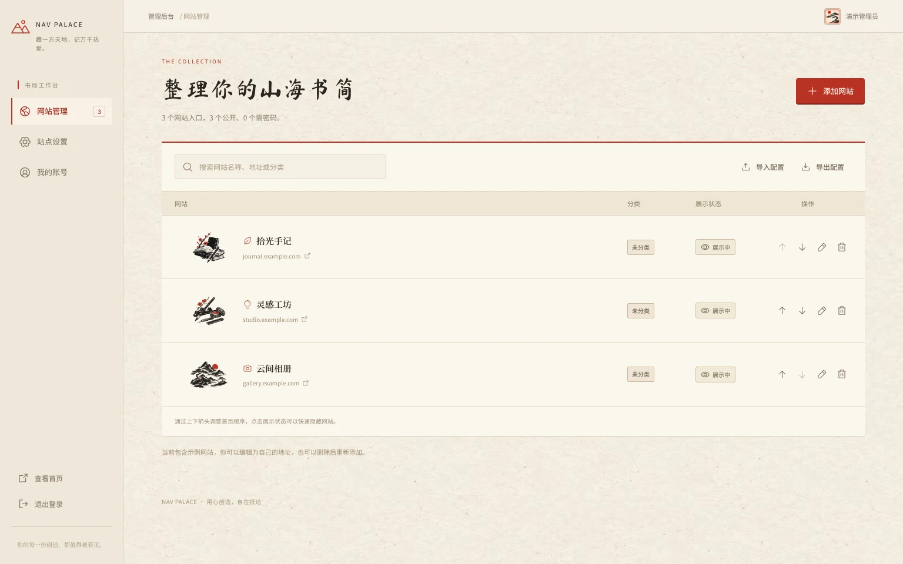

# Nav Palace

让热爱，有处可达。

Nav Palace 是一个可自行部署的水墨风导航站，用来集中展示自己的项目和网站。在后台添加入口、调整顺序和可见性，首页会读取最新配置。数据保存在本地 SQLite 文件中。

## 页面预览

**水墨首页** · 点击插画翻看站点介绍，点击标题或红色箭头访问站点。


**网站管理** · 在后台添加入口、调整展示顺序和可见性，也可以导入和导出配置。



## 功能

- 管理网站链接、简介、封面和图标，支持隐藏入口和设置独立访问密码。
- 自定义站点文案与 Logo，内置 20 张水墨封面和 10 款水墨 Logo。
- 上传时自动压缩并生成缩略图，页面按需加载图片和字体。
- 支持 JSON 配置导入导出、SQLite 备份和 Docker 部署。

## 本地启动

需要 Node.js 22.16 或更新版本。

```bash
npm ci
npm run setup:env
npm run dev
```

打开 [首页](http://127.0.0.1:3000)。首次访问 [初始化页面](http://127.0.0.1:3000/admin/setup)，使用 `.env.local` 中的 `SETUP_TOKEN` 创建管理员，之后从 `/admin` 管理网站。初始提供三条演示入口，可在后台替换。

开发模式下，从 `localhost` 或 `127.0.0.1` 打开同一个本地端口时，页面会自动跳到 `.env.local` 配置的访问地址。

## Docker 部署

### 使用预构建镜像

部署服务器只需 Docker 和 Compose。以下步骤使用已经发布的镜像。

1. 创建部署目录，并把本项目的 [compose.yaml](compose.yaml) 复制到该目录。

   ```bash
   mkdir -p ~/nav-palace
   cd ~/nav-palace
   ```

2. 在 `compose.yaml` 同目录手动创建 `.env`，将镜像地址和域名换成你的实际值。Compose 会自动读取这个文件。

   ```dotenv
   NAV_PALACE_IMAGE=registry.example.com/your-org/nav-palace:1.0.0
   BETTER_AUTH_URL=https://nav.example.com
   HOST_IP=127.0.0.1
   PORT=30010
   ```

   Docker 默认将宿主机的 `30010` 端口映射到容器内的 `3000` 端口。`BETTER_AUTH_URL` 是浏览器实际访问的完整地址。反向代理与应用在同一台服务器时，可以保留 `HOST_IP=127.0.0.1`，让代理转发到 `127.0.0.1:30010`。如果直接通过服务器 IP 访问，把 `HOST_IP` 改为 `0.0.0.0`，并在 `BETTER_AUTH_URL` 中填入实际 IP 和映射端口，例如 `http://10.211.55.10:30010`。已有部署也需将 `.env` 中的 `PORT` 更新为 `30010`，再运行 `docker compose up -d` 应用变更。

3. 拉取镜像并启动容器，然后检查状态和启动日志。

   ```bash
   docker compose up -d --pull always
   docker compose ps
   docker compose logs app
   ```

4. 打开日志中显示的 `/admin/setup` 地址，用日志中的 `SETUP_TOKEN` 创建管理员，之后通过 `/admin` 登录。首次启动时，容器会自动生成认证密钥和初始化令牌，并将它们保存到命名卷。

更新时，在 `.env` 里修改 `NAV_PALACE_IMAGE`，再执行 `docker compose up -d --pull always`。沿用原部署目录和数据卷，数据库、上传文件与凭据会继续使用。旧部署升级时，可以把原有的 `BETTER_AUTH_SECRET` 和 `SETUP_TOKEN` 一并写入 `.env`，新版容器首次启动时会将它们保存到数据卷。

### 从源码制作镜像

在有源码的机器上构建并发布镜像。部署服务器在 `.env` 中使用相同的镜像标签。

```bash
docker build -t registry.example.com/your-org/nav-palace:1.0.0 .
docker push registry.example.com/your-org/nav-palace:1.0.0
```

## 数据与备份

本地数据默认存放在 `data/`，Docker 使用 `nav-palace-data` 持久化卷。Docker 部署可用 `docker compose exec app node scripts/backup.mjs /app/data/nav-palace-backup.db` 生成数据库快照。完整备份还需保留卷内的 `uploads/` 和 `.nav-palace-runtime.json`，后者包含用于恢复登录和初始化的凭据。

后台 JSON 导出用于迁移网站与站点设置。完整迁移还需 SQLite 快照和上传目录。

## 开发与许可

项目使用 Next.js、TypeScript 和 SQLite。开发检查可运行 `npm run lint`、`npm test` 和 `npm run build`。实现细节见[架构文档](docs/architecture.md)。

项目代码采用 [Apache-2.0](LICENSE) 许可。字体、图标和素材来源见 [NOTICE.md](NOTICE.md)。
